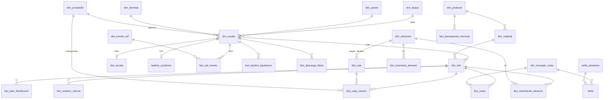

# Modelo de datos — ciclo de importación de macroinsumos

Esquema estrella en Supabase (Postgres) que cubre todo el recorrido de la carga:
**buque → escala en puerto → descarga → laytime (despatch/demurrage) → distribución
en camión → almacén tercero (AT) → planta (PAB) → mermas → costos real / plan /
presupuesto.**

Migración: [`supabase/migrations/20261019120000_modelo_dimensional.sql`](../supabase/migrations/20261019120000_modelo_dimensional.sql).
No toca las tablas que ya usa la app (`tarifa_*`, `naves_historico`, `simulaciones`); el
tarifario nuevo reutiliza `tarifa_versiones` para tener un solo gobierno de versiones.

## Diagrama



## Conceptos clave

| Concepto | Tabla | Por qué es así |
|---|---|---|
| **Buque** | `dim_buque` | El barco físico. DIAMOND SKY vino en ene-26 y set-26: es 1 buque y 2 escalas. |
| **Escala** | `dim_escala` | Una visita de un buque a un puerto/terminal. Unidad de operación portuaria, agencia y **laytime**. |
| **Lote** | `dim_lote` | Parcela de una escala para un material (= una fila de la hoja BASE). QUEST trajo maíz y torta: 1 escala, 2 lotes. Unidad de **balance de masa, merma y costo**. |
| **Ubicación** | `dim_ubicacion` | Cualquier nodo donde puede estar la carga: `TERMINAL` (APM, COSCO), `ALMACEN_TERCERO` (2111, 2110, 2129, 2130, DEPSA) y `PLANTA` (5001, 1028, 5003, 5029). |
| **Ruta** | `dim_ruta` | Origen → destino. El tramo (`PUERTO_PLANTA`, `PUERTO_ALMACEN`, `ALMACEN_PLANTA`, …) se calcula solo, a partir de los tipos de nodo. Las tarifas de flete cuelgan de la ruta. |
| **Alias** | `dim_proveedor_alias`, `dim_ubicacion_alias` | Las fuentes escriben lo mismo de muchas formas ("TOSA", "TOSAE.I.R.L.", "5029 - GH", "GHCORP - 5029"). Toda carga resuelve ids por alias, nunca por texto libre. |

## Tablas de hechos y su grano

| Tabla | Grano (1 fila =) | Fuente actual |
|---|---|---|
| `fact_escala` | 1 escala (snapshot acumulativo de hitos: rada, NOR, atraque, inicio/fin de descarga, desatraque) | — (pendiente: reportes de agencia) |
| `fact_sof_evento` | 1 intervalo del Statement of Facts (opcionalmente por bodega), con factor de laytime 0 / 0.5 / 1 | — (pendiente: Laytime2025) |
| `fact_laytime_liquidacion` | 1 versión de liquidación de laytime por escala (calculada → presentada → acordada → facturada) | — |
| `fact_descarga_diaria` | escala × lote × día × turno × bodega | — |
| `fact_plan_distribucion` | lote × destino × versión de plan | **BASE** (PLAN PAB …) |
| `fact_viaje_camion` | 1 viaje de camión (guía / ticket de balanza) por ruta | **BASE**, agregado (ver abajo) |
| `fact_movimiento_almacen` | 1 movimiento (ingreso / salida / ajuste) de un lote en un AT, con fecha | — (pendiente: GANTT AT) |
| `fact_inventario_almacen` | fecha de corte × AT × lote: saldo físico vs. SAP | — (pendiente: ERI) |
| `fact_reclamo_merma` | 1 reclamo por lote y etapa de merma | **BASE** (penalidades) |
| `fact_costo` | escenario × lote × concepto × proveedor × ubicación/ruta × documento | **BASE** (real, plan, presupuesto) |
| `fact_presupuesto_mensual` | mes × producto | — (pendiente: PRESUPUESTOS) |

`fact_costo` usa **el mismo grano para REAL, PLAN, PRESUPUESTO y SIMULACION**, así que
cualquier comparación es un `group by escenario`. Cada línea guarda moneda, monto original
y tipo de cambio; `monto_pen` se calcula.

## Reglas de negocio implementadas

- **Tolerancia de balanza por viaje:** `diferencia_kg = peso_llegada − peso_salida`. Si pasa
  de ±40 kg (`tolerancia_kg`), el exceso va a `kg_en_contra` (penalidad al transportista) o a
  `kg_a_favor`. Es la misma fórmula de las hojas PUERTO - PAB+AT y TERCEROS A PLANTA. En
  filas agregadas no se calcula, porque la tolerancia es por viaje.
- **Merma por etapa** (`v_lote_balance_masa`, `v_lote_merma_etapa`):
  - travesía = manifestado − salida de terminal
  - transporte = salida de terminal − ingreso (PAB directo + AT)
  - almacenamiento = ingreso AT − salida AT, **solo si el AT ya se cerró** (`dim_lote.almacen_cerrado`); mientras tanto la diferencia es stock (`tm_stock_almacen`)
  - traslado = salida AT − llegada a PAB
- **Laytime** (`fn_laytime_horas_usadas`, `v_laytime_escala`): permitido = TM manifestadas /
  tasa C/P × 24. Usado = intervalos del SOF × factor, cortados por día en hora de Lima. En
  `SHEX` se excluyen domingos y feriados (`dim_fecha.es_feriado`, incluye Semana Santa), y en
  `SSHEX` también los sábados. Demurrage = exceso × USD/día; despatch = ahorro × USD/día. El
  turn time se registra como evento `TURN_TIME` (factor 0) en el SOF.
- **Tarifas inmutables:** `tarifa` solo admite INSERT (RLS). Corregir un precio significa
  crear una nueva `tarifa_versiones`.

## Consultas típicas

```sql
-- ¿Cómo se distribuyó una nave? (plan vs. real por planta, si pasó por AT, stock pendiente)
select destino, tipo_destino, tm_plan, tm_recibida_desde_puerto, tm_recibida_desde_almacen,
       tm_total_planta, tm_despachada_a_planta, tm_stock_almacen, pct_del_lote, desvio_vs_plan_tm
from v_lote_distribucion where buque = 'KACEY' order by tipo_destino desc, destino;

-- Recorrido físico tramo a tramo (terminal -> AT -> PAB)
select tramo, origen, destino, tm_salida, tm_llegada, diferencia_tm from v_lote_flujo where buque = 'KACEY';
```

`pct_del_lote` es, en las plantas, la parte del lote que terminó en esa planta (por
cualquier vía); en los almacenes es la parte del lote que pasó por ese AT.

## Carga de la hoja BASE (fase actual)

```bash
# 1) Excel -> staging (archivo con datos de la empresa: queda en etl/out/, ignorado por git)
python3 etl/base_a_staging.py "MACROINSUMOS_2025-2026.xlsx" etl/out/staging_base.sql
# 2) aplicar en Supabase (SQL Editor, o psql con la cadena de conexión del proyecto)
psql "$SUPABASE_DB_URL" -f etl/out/staging_base.sql -f etl/transformar_base.sql
# 3) conciliar: todos los controles deben dar 0 lotes con diferencia
psql "$SUPABASE_DB_URL" -f etl/validar_base.sql
```

Qué se puede granular desde BASE y qué no:

- **Viajes:** BASE trae totales por lote y destino, así que cada fila de `fact_viaje_camion`
  es `es_agregado = true` (todos los viajes del lote a ese destino). Al cargar las hojas de
  balanza se reemplazan por viajes reales, sin cambiar el modelo.
- **Almacén → planta:** BASE da salidas por almacén y llegadas por planta, pero no el cruce.
  Con más de un almacén o planta se reparte en proporción, lo que preserva ambos totales.
- **Costos:** el flete se abre por ruta (TM × tarifa) y la descarga de 2026 por componente
  (terminal, surveyor, agencia, balanza). La de 2025 queda como tarifa integral. Lo que no se
  puede abrir iría a una línea `AJ_*` de conciliación; con la BASE actual no hizo falta
  ninguna.

Conciliación al 19-oct-2026: los **73 lotes** cuadran con BASE en TM descargadas, TM
ingresadas, merma total y costo real / plan / presupuesto.

## Próximas fuentes (mismas tablas, más detalle)

| Fuente | Llena |
|---|---|
| PUERTO - PAB+AT (30 mil viajes), TERCEROS A PLANTA (3 mil viajes) | `fact_viaje_camion` a nivel viaje + penalidades reales por transportista |
| GANTT AT / CONTROL DE MERMAS AT | `fact_movimiento_almacen` con fechas → días de permanencia, TM-mes |
| RESUMEN GASTOS / GASTOS | `fact_costo` por factura (proveedor, factura, HES, CeCo) |
| ERI | `fact_inventario_almacen` |
| PRESUPUESTOS | `fact_presupuesto_mensual` |
| Laytime / SOF de agencia | `laytime_condicion`, `fact_sof_evento`, `fact_escala`, `fact_laytime_liquidacion` |
